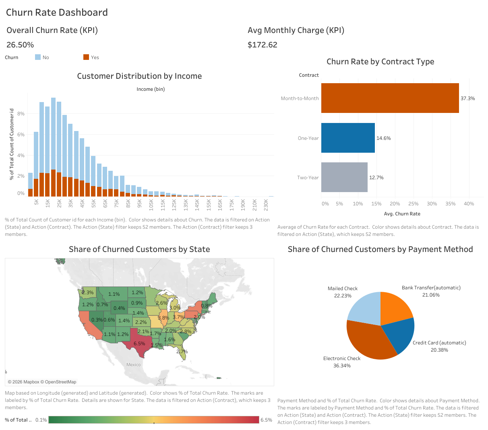

# Telecom customer churn dashboard

**Which customers should a retention team reach first?** I built a Tableau dashboard for a telecom leadership team to compare churn across contracts, income levels, states and payment methods. Of 10,000 customers, 2,650 churned. The clearest starting point for a retention experiment was the month-to-month group.

[Open the interactive dashboard](https://public.tableau.com/shared/Z8Z9SR2NB?:display_count=n&:origin=viz_share_link) · [Follow the technical walkthrough](docs/technical-walkthrough.md) · [Download the Tableau workbook](tableau/customer_churn_dashboard.twbx)

## What the retention team can learn

| Contract | Customers who churned | Customers on contract | Churn rate |
|---|---:|---:|---:|
| Month-to-month | 2,034 | 5,456 | 37.28% |
| One year | 307 | 2,102 | 14.61% |
| Two year | 309 | 2,442 | 12.65% |

These rates use the customers on each contract as the denominator. A retention manager could test an offer with month-to-month customers and use a holdout group to measure whether it changes churn. The dashboard alone cannot tell whether switching contracts would keep a customer.

## Inspect the workbook

Start with all states and contracts selected. Overall churn is **26.50%** and the average monthly charge is **$172.62**. Select a state on the map and watch the KPIs and contract view update together. Labels and a color-blind palette help readers follow the changes. [State-filter demonstration, 27 seconds](docs/state-filter-demo.mp4)

The walkthrough also explains a common source of confusion. Electronic-check users account for 36.34% of all customers who churned, while 28.34% of electronic-check users churned. Those percentages answer different questions. [Source data](data/telecom_churn.csv) · [Contract chart](assets/state_churn_map.png) · [State map](assets/contract_type_churn.png)

*Coursework for the M.S. in Data Analytics at Western Governors University (WGU), D601 Data Storytelling.*
